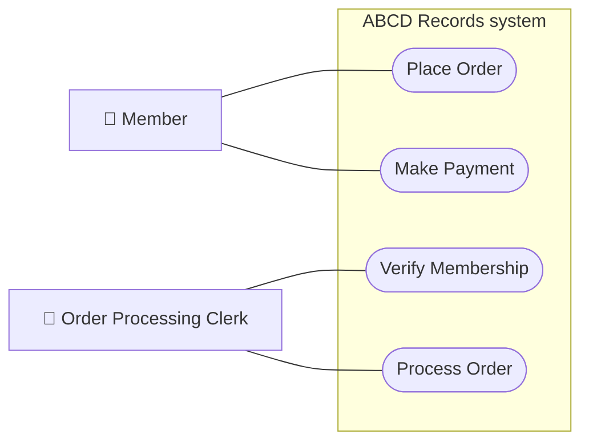
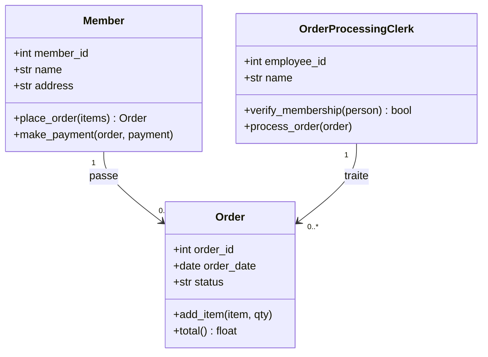
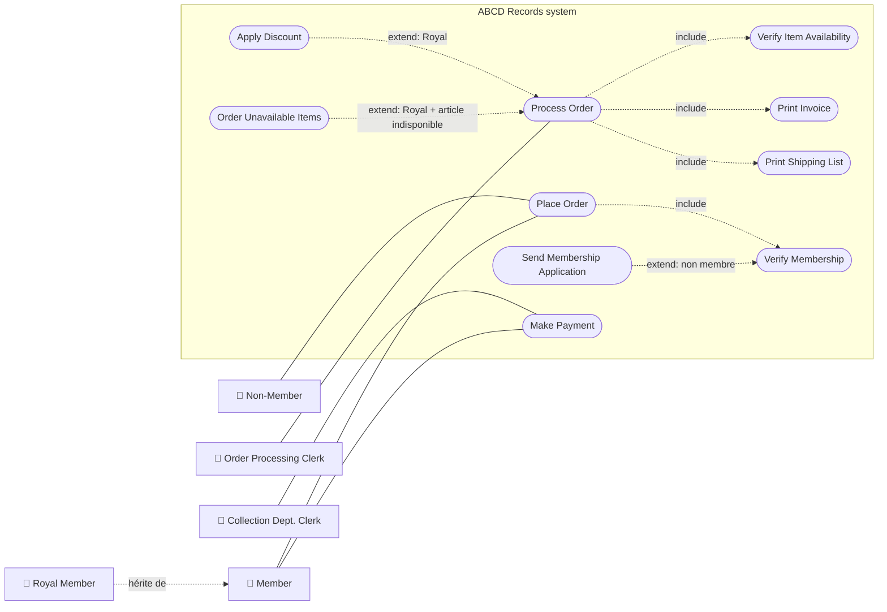
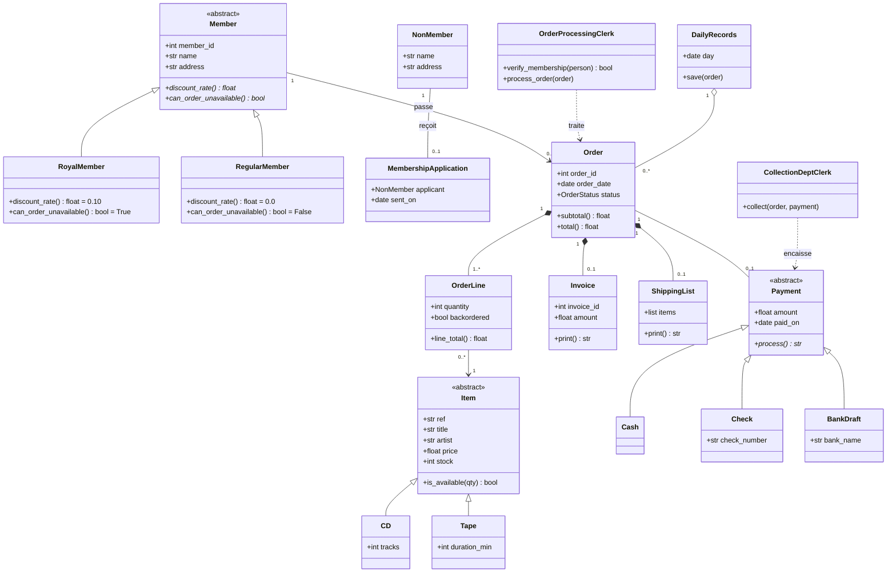
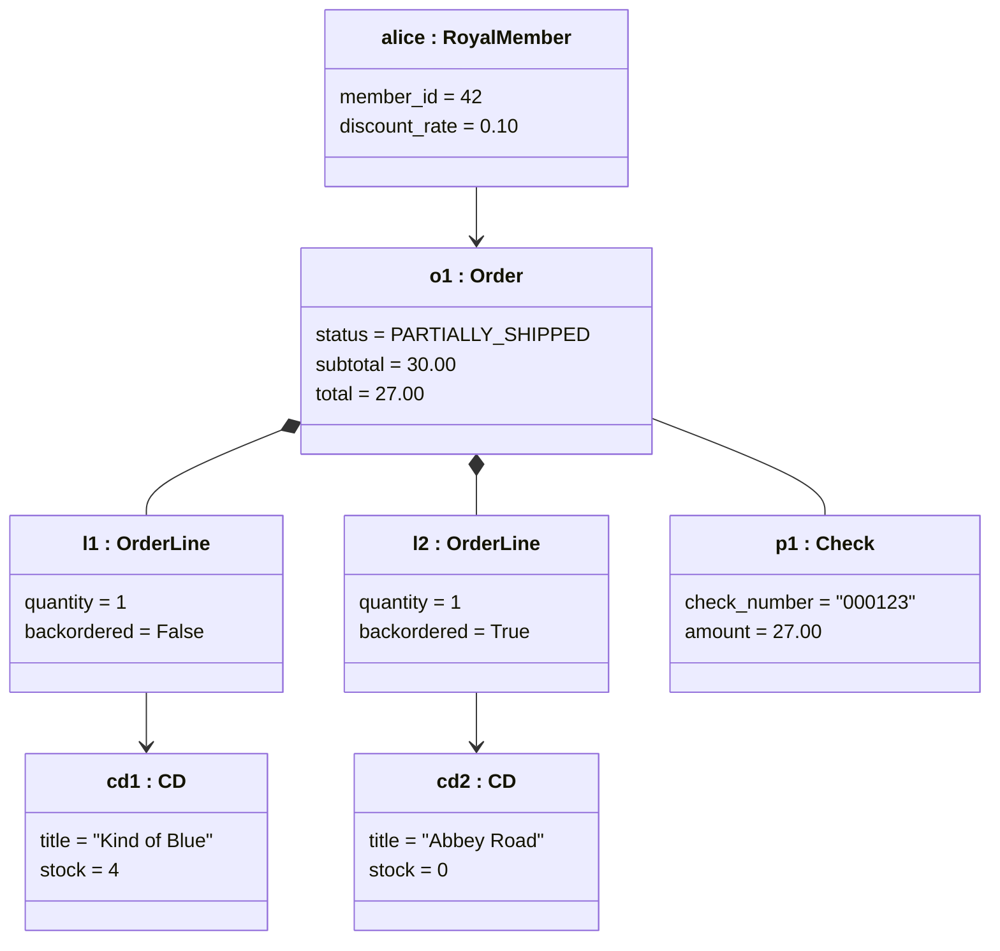
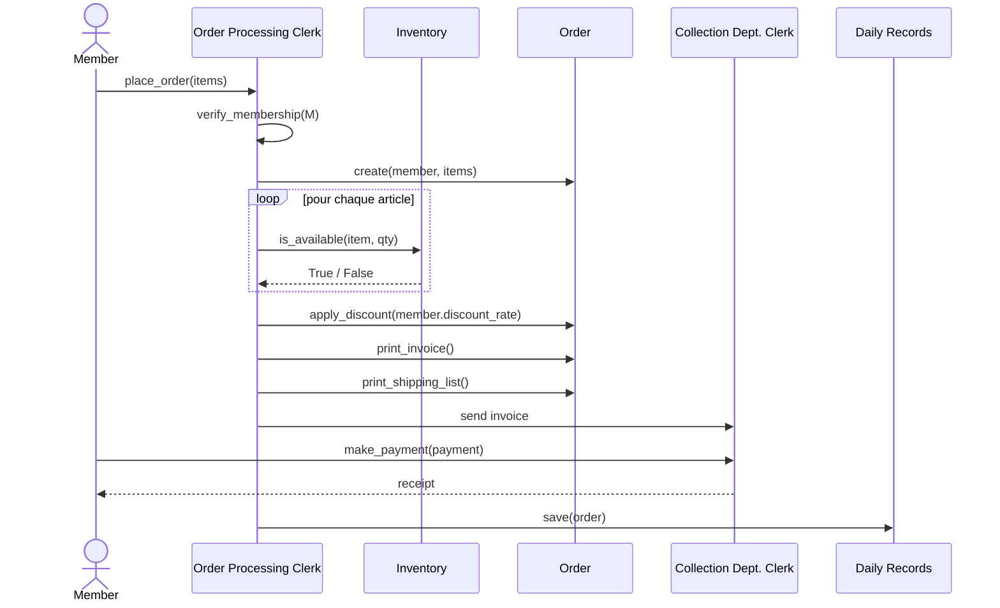
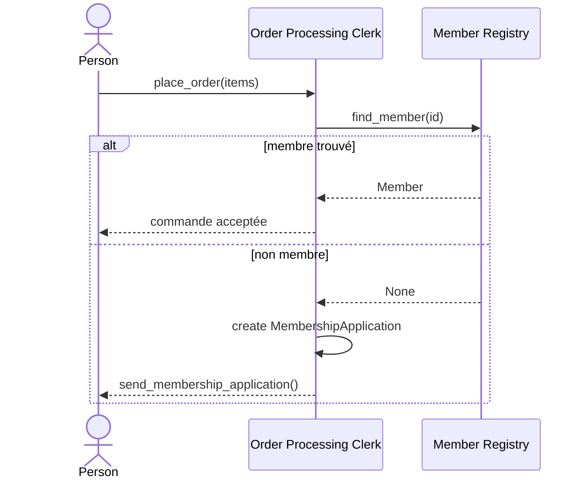
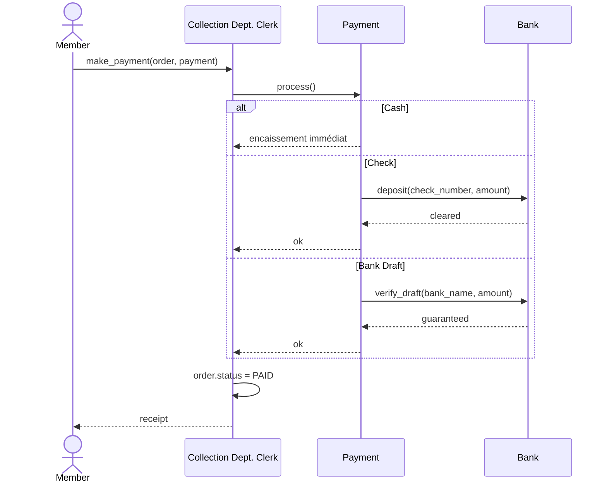
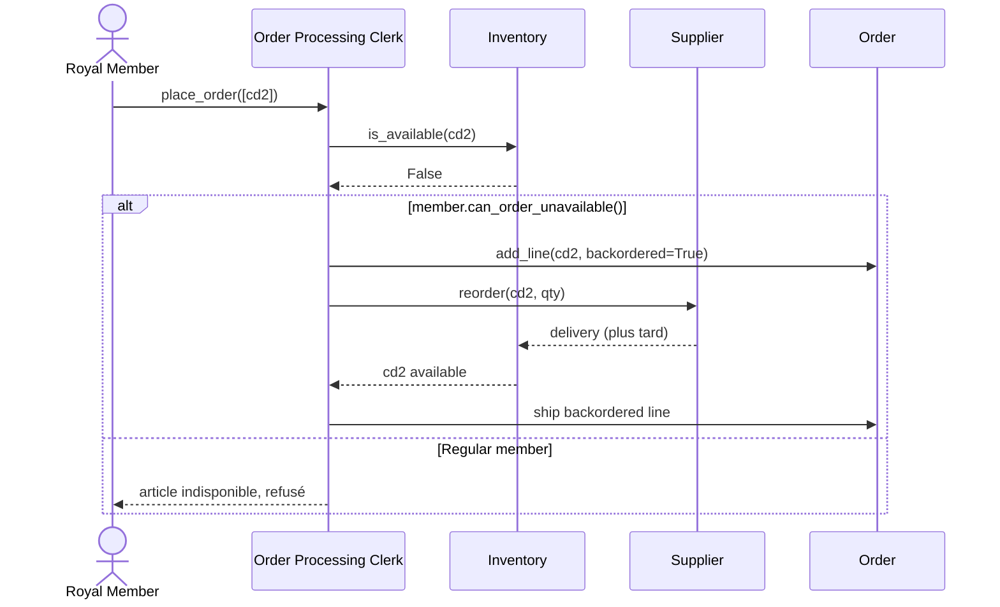

# Exo 2 - ABCD Records 📼

Énoncé : <https://gist.github.com/bdallard/2d2407c4de4c182afca6d3ec7235e9eb>
Implémentation Python : [`abcd_records.py`](abcd_records.py)

> Mermaid n'a pas de vrai diagramme de cas d'utilisation : les use cases sont
> représentés par des ovales (`([...])`), les acteurs par des nœuds 👤, et la
> frontière du système par un `subgraph`.

## Level 1

### Task 1.1 - Use case diagram (simple)

### Task 1.2 - Class diagram (simple)

## Level 2

### Task 2.1 - Use case diagram complet

- **include** (obligatoire) : passer commande implique *toujours* de vérifier
  l'adhésion ; traiter une commande implique *toujours* de vérifier le stock,
  d'imprimer la facture et la liste d'expédition.
- **extend** (optionnel) : la remise et la commande d'articles indisponibles
  n'ont lieu que pour un membre Royal ; le formulaire d'adhésion n'est envoyé
  que si la vérification échoue.

### Task 2.2 - Class diagram complet

#### Scénario : un membre Royal commande 2 CDs (dont un indisponible) et paie par chèque

Diagramme d'objets (état après traitement) :

## Level 3 - Sequence diagrams

### 1. Complete Order Processing Flow

### 2. Membership Verification (succès et échec)

### 3. Payment Processing (tous les types)

### 4. Item Reordering for Royal Members

