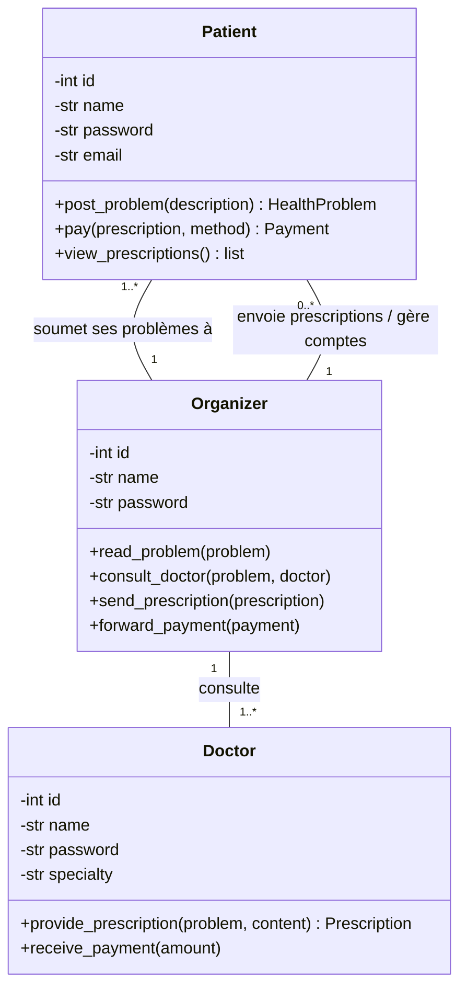
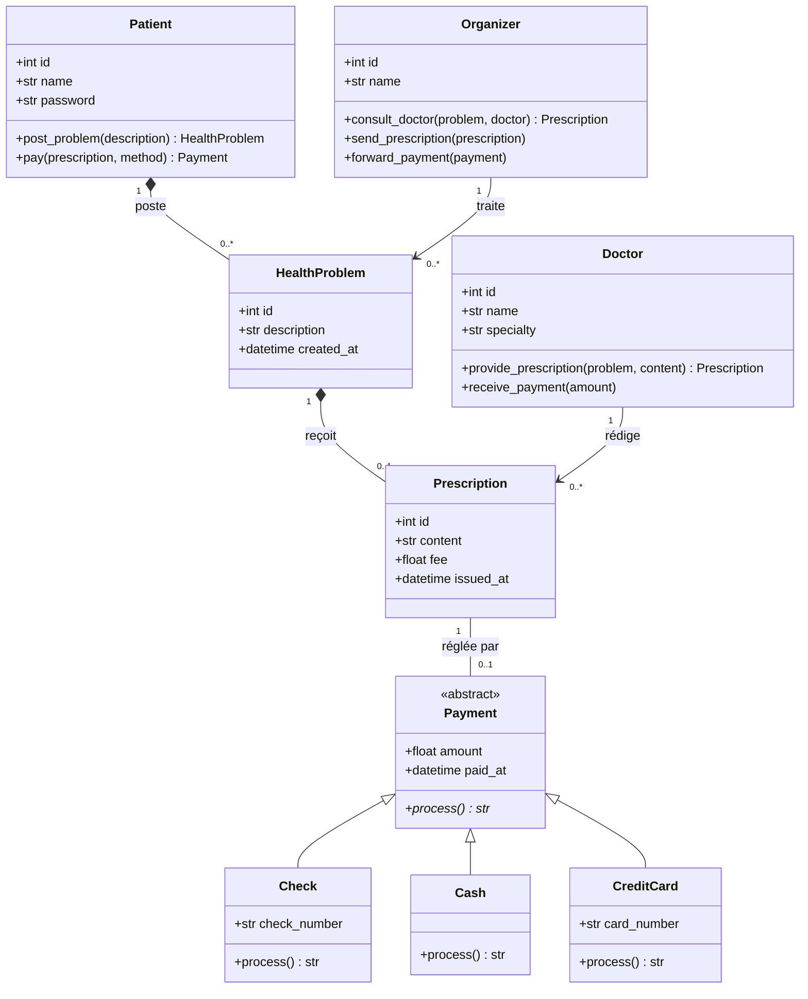
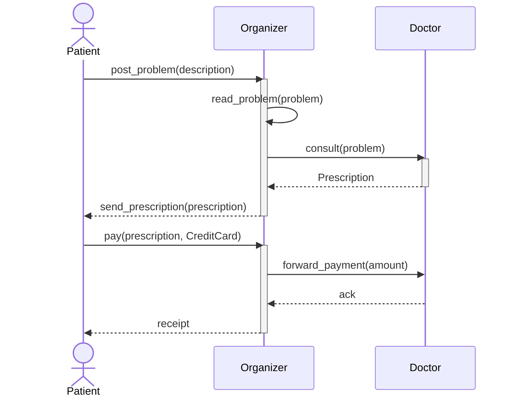
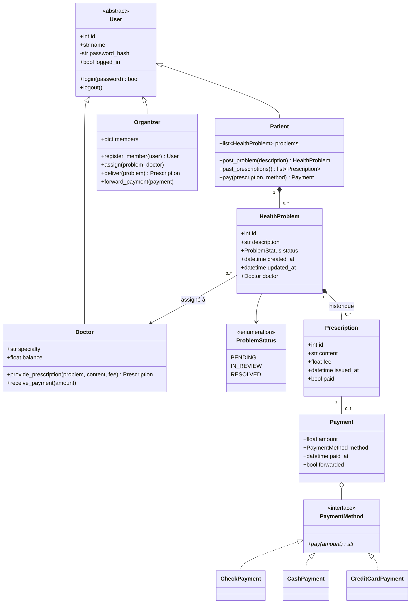
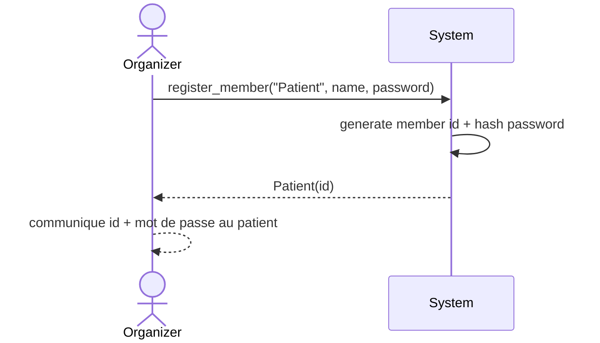
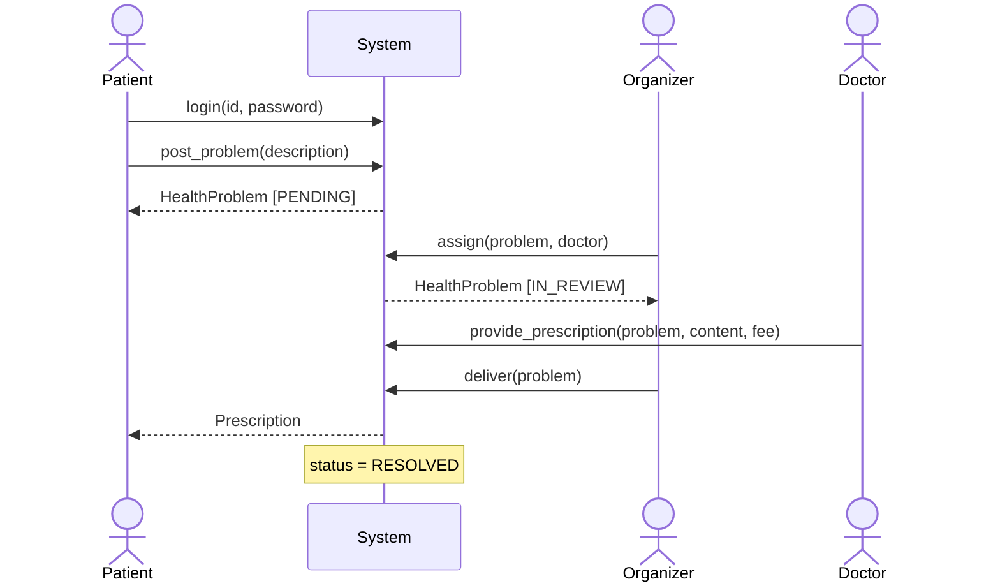
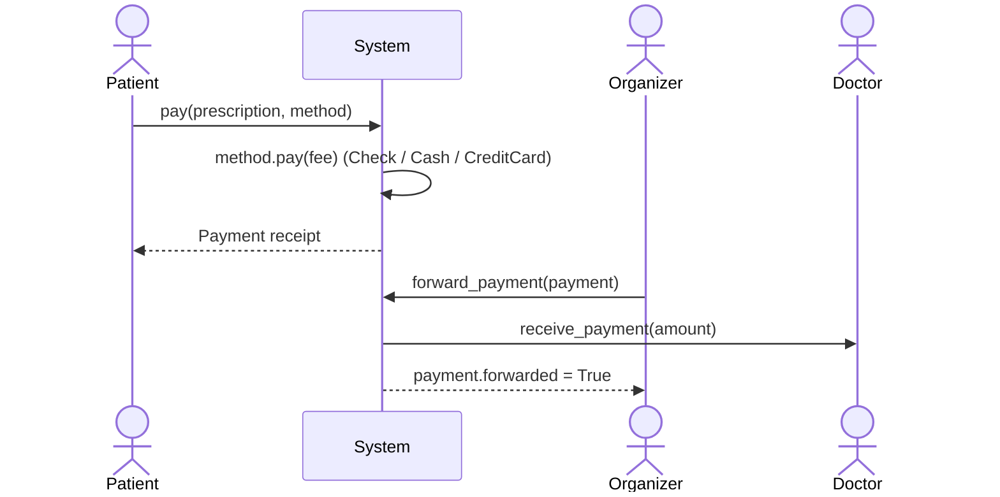

# Exo 1 - Hospital Management System 🏥

Énoncé : <https://gist.github.com/bdallard/2d2407c4de4c182afca6d3ec7235e9eb>
Implémentation Python : [`hospital.py`](hospital.py)

## Task 1 - Diagramme de classes de base

## Task 2 - Diagramme complet (6 classes)

- **Composition** `Patient *-- HealthProblem` : un problème n'existe pas sans son patient.
- **Composition** `HealthProblem *-- Prescription` : la prescription répond à un problème.
- **Inheritance** pour les moyens de paiement (`Payment` abstrait → `Check`, `Cash`, `CreditCard`).

### Séquence : un patient soumet un problème, reçoit une prescription et paie

## Task 3 - Version avancée

Ajouts : superclasse `User` (id, name, password, login/logout), statut
`ProblemStatus` (PENDING → IN_REVIEW → RESOLVED), timestamps, historique des
prescriptions, paiement modélisé par **polymorphisme (pattern Strategy)**.

### SSD 1 - Patient Registration

### SSD 2 - Consultation Flow

### SSD 3 - Payment Processing

## Questions to consider

1. **Patient qui consulte plusieurs médecins ?** Chaque `HealthProblem` porte
   sa propre référence `doctor` : un patient a plusieurs problèmes, chacun
   pouvant être assigné à un médecin différent (relation `Patient 1 -- * HealthProblem * -- 0..1 Doctor`).
   Pour un même problème vu par plusieurs médecins, on remplace l'attribut par
   une liste de `Consultation(doctor, date, notes)`.
2. **Prescriptions réutilisables ?** Oui pour un traitement renouvelable : on
   garde l'historique (`HealthProblem *-- Prescription`) et on ajoute une
   méthode `renew()` qui crée une nouvelle `Prescription` liée à l'originale
   (`renewed_from`), plutôt que de modifier l'ancienne (traçabilité).
3. **Pattern pour le paiement ?** **Strategy** : `PaymentMethod` est
   l'interface, `CheckPayment` / `CashPayment` / `CreditCardPayment` sont les
   stratégies interchangeables. Une **Factory** peut créer la bonne stratégie
   à partir du choix du patient.
4. **Intégrité des paiements ?** Transaction atomique (le paiement et le
   marquage `paid` réussissent ou échouent ensemble), interdiction du double
   paiement (`if prescription.paid: raise`), idempotence via un id de
   transaction, journal d'audit, montants vérifiés côté serveur,
   `forward_payment` impossible deux fois (`forwarded`).

---

## Exo 2 - ABCD Records

Voir [`abcd_records_uml.md`](abcd_records_uml.md).
