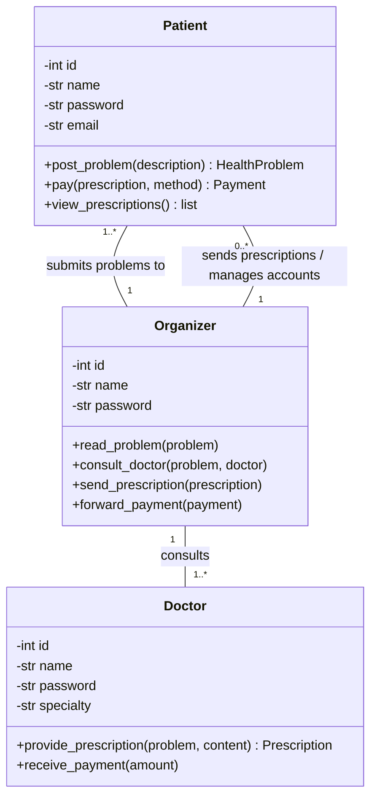
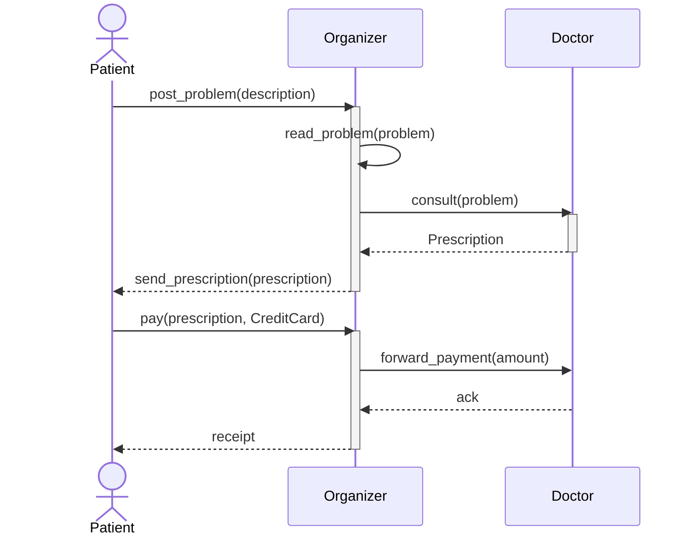
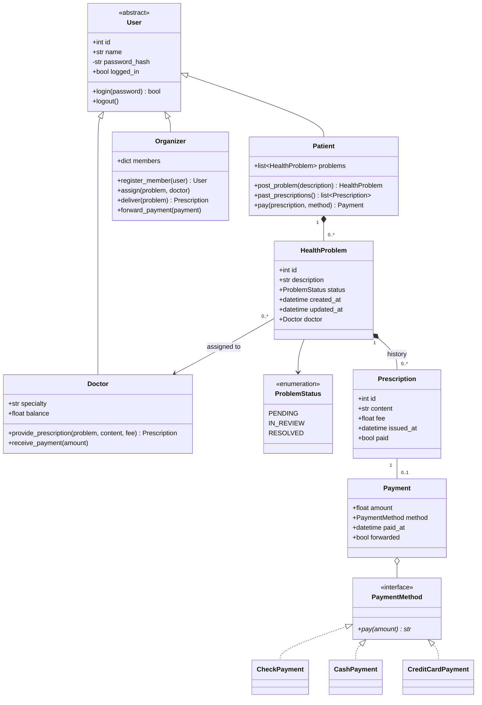
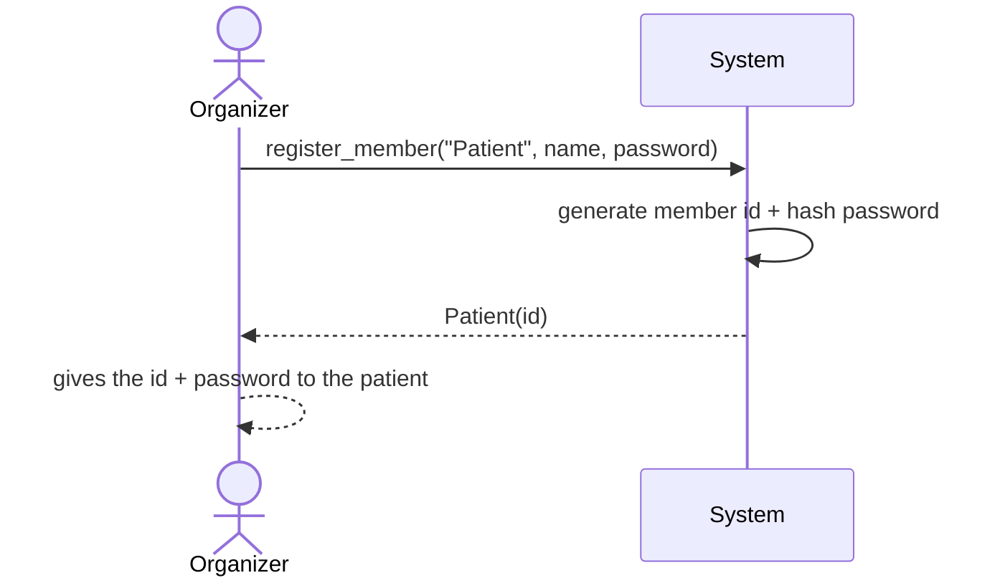
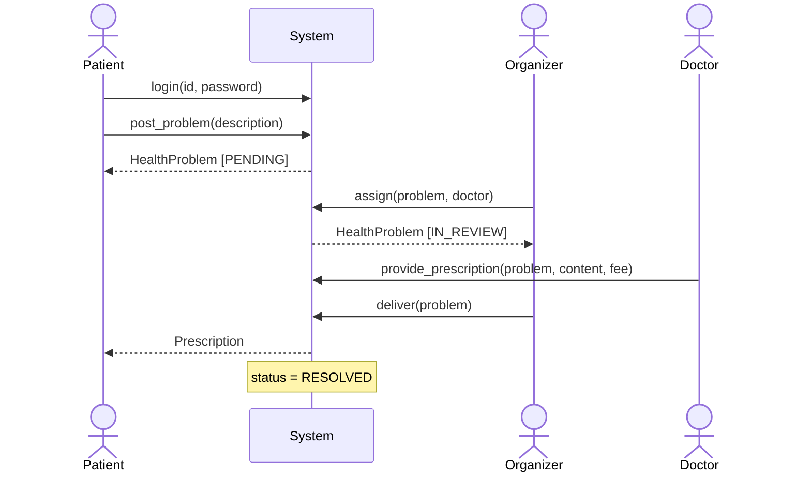
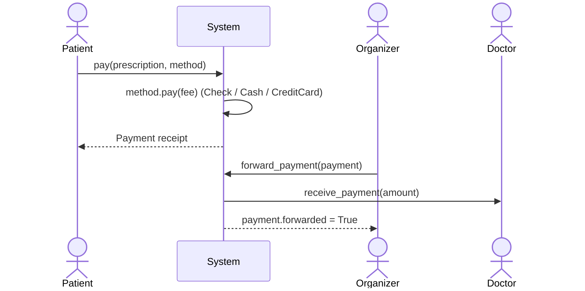

# Exo 1 - Hospital Management System 🏥

Exercise: <https://gist.github.com/bdallard/2d2407c4de4c182afca6d3ec7235e9eb>
Python implementation: [`hospital.py`](hospital.py)

## Task 1 - Basic class diagram

## Task 2 - Complete diagram (6 classes)

- **Composition** `Patient *-- HealthProblem`: a problem cannot exist without its patient.
- **Composition** `HealthProblem *-- Prescription`: a prescription answers one problem.
- **Inheritance** for the payment methods (abstract `Payment` → `Check`, `Cash`, `CreditCard`).

### Sequence: a patient submits a problem, receives a prescription and pays

## Task 3 - Advanced version

Additions: a `User` superclass (id, name, password, login/logout), a
`ProblemStatus` (PENDING → IN_REVIEW → RESOLVED), timestamps, prescription
history, and payment modelled with **polymorphism (Strategy pattern)**.

### SSD 1 - Patient Registration

### SSD 2 - Consultation Flow

### SSD 3 - Payment Processing

## Questions to consider

1. **A patient consulting several doctors?** Each `HealthProblem` holds its
   own `doctor` reference: a patient has several problems, and each one can be
   assigned to a different doctor (`Patient 1 -- * HealthProblem * -- 0..1 Doctor`).
   For one problem seen by several doctors, replace the attribute with a list
   of `Consultation(doctor, date, notes)`.
2. **Should prescriptions be reusable?** Yes for a renewable treatment: keep
   the history (`HealthProblem *-- Prescription`) and add a `renew()` method
   that creates a new `Prescription` linked to the original one
   (`renewed_from`), rather than modifying the old one (traceability).
3. **Which pattern fits the payment system?** **Strategy**: `PaymentMethod` is
   the interface, `CheckPayment` / `CashPayment` / `CreditCardPayment` are
   interchangeable strategies. A **Factory** can create the right strategy
   from the patient's choice.
4. **Data integrity when payments are processed?** An atomic transaction (the
   payment and the `paid` flag succeed or fail together), no double payment
   (`if prescription.paid: raise`), idempotency through a transaction id, an
   audit log, amounts checked server-side, and `forward_payment` impossible
   twice (`forwarded`).

---

## Exo 2 - ABCD Records

See [`abcd_records_uml.md`](abcd_records_uml.md).
