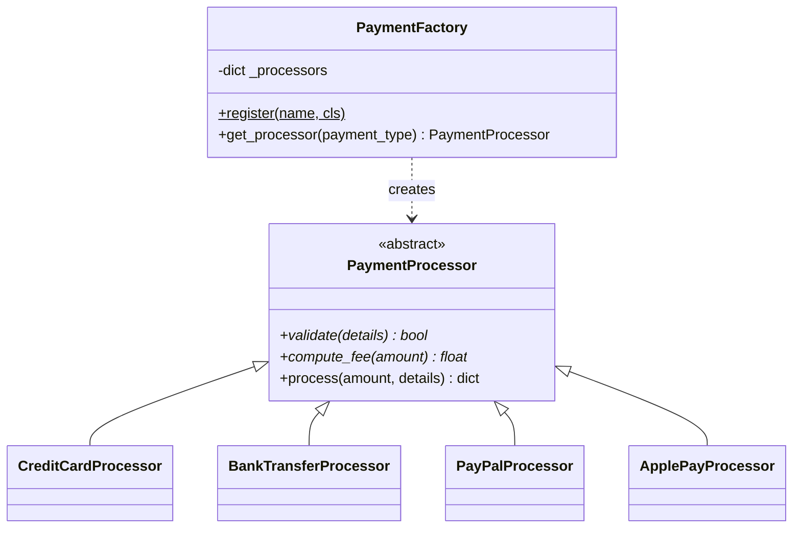
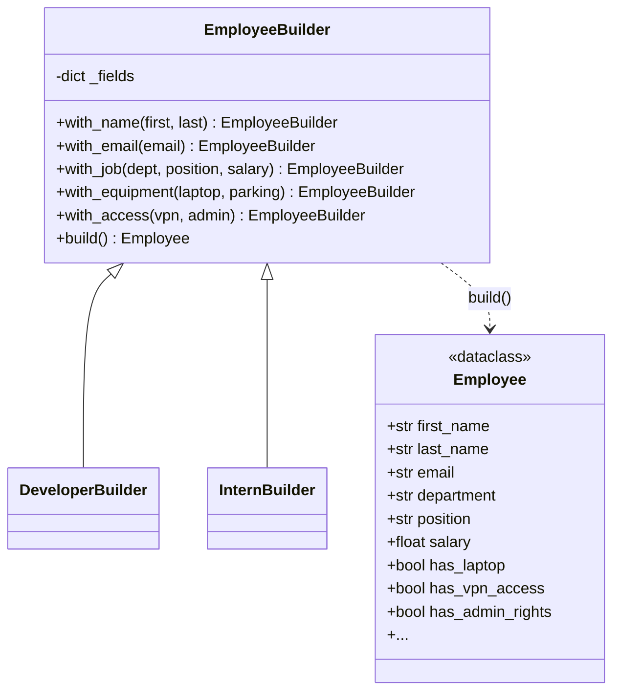
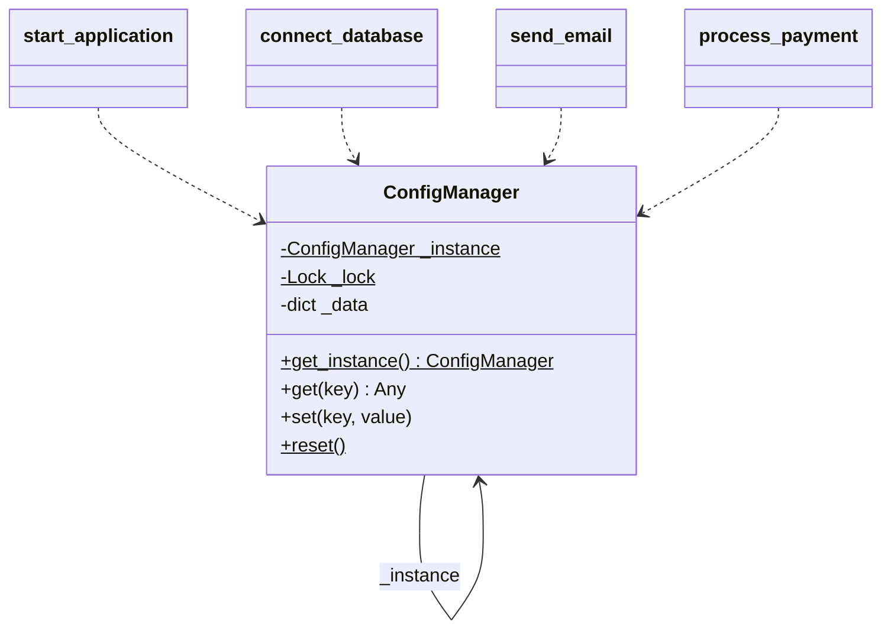
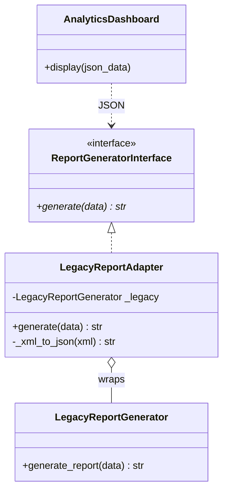
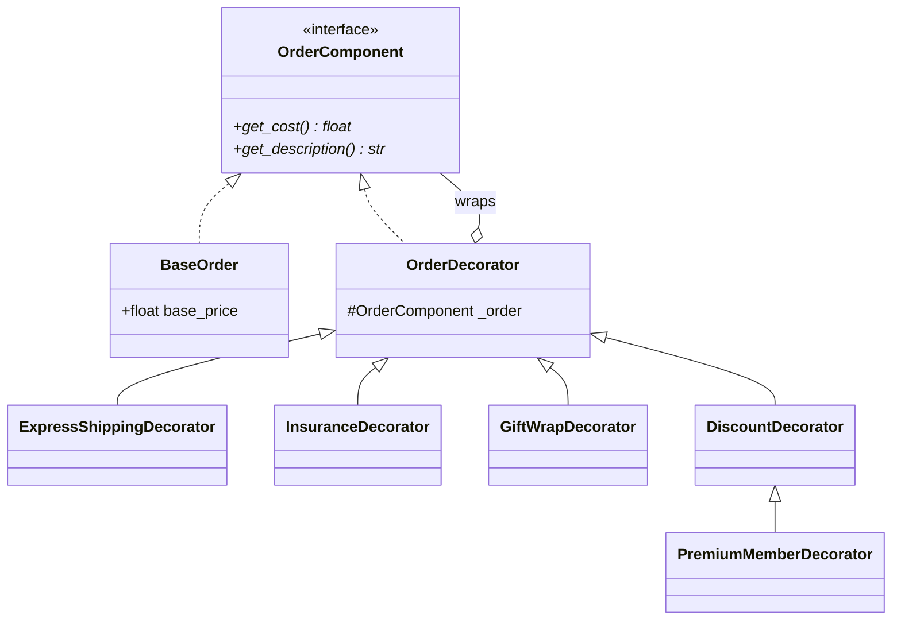
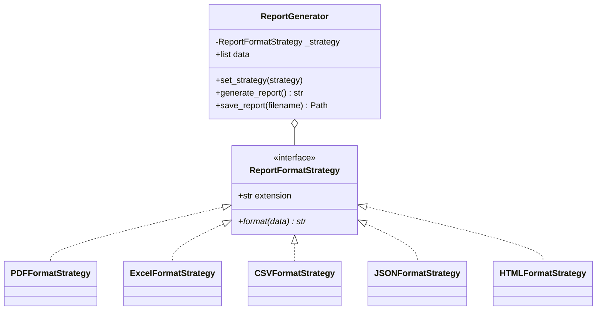
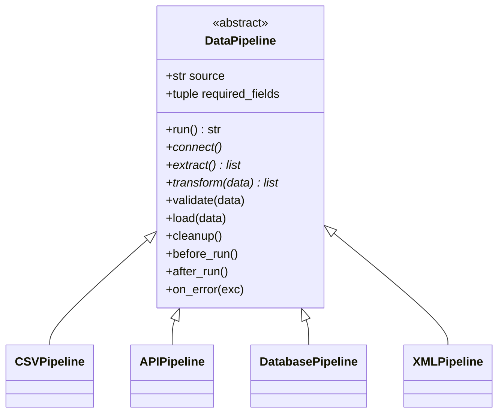

# 05 - Design patterns in practice

Exercises:
[creational](https://courses.dallard.tech/sys_design/creational_pattern/) ·
[structural](https://courses.dallard.tech/sys_design/structural_pattern/) ·
[behavioral](https://courses.dallard.tech/sys_design/behavioral_pattern/)

Each file's docstring lists the *problems found* in the legacy code, then
the refactored solution follows. The UML diagrams the exercises ask for
before coding are below.

| Pattern | File | Exercise |
|---|---|---|
| Factory Method | [`creational/factory.py`](creational/factory.py) | payment system |
| Builder | [`creational/builder.py`](creational/builder.py) | HR onboarding |
| Singleton | [`creational/singleton.py`](creational/singleton.py) | configuration manager |
| Adapter | [`structural/adapter.py`](structural/adapter.py) | XML → JSON reports |
| Decorator | [`structural/decorator.py`](structural/decorator.py) | order pricing |
| Strategy | [`behavioral/strategy.py`](behavioral/strategy.py) | multi-format reports (+ HTML) |
| Template Method | [`behavioral/template_method.py`](behavioral/template_method.py) | ETL pipelines (+ XML) |

```bash
python 05_design_patterns/creational/factory.py   # etc.
pytest tests/test_design_patterns.py
```

## Factory Method



## Builder



## Singleton



## Adapter



## Decorator



Example from the exercise (100 € + express + insurance + gift wrap, -15%, -10% premium):
`(100 + 15 + 5 + 5) × 0.85 × 0.90 ≈ 95.62 €`.

## Strategy



> Note: on the course website this exercise is filed under "Template Method",
> but it explicitly asks for a **Strategy** pattern.

## Template Method



`run()` fixes the order `connect → extract → transform → validate → load → cleanup`;
`cleanup()` runs in a `finally` block, so it can never be skipped, even on errors.
