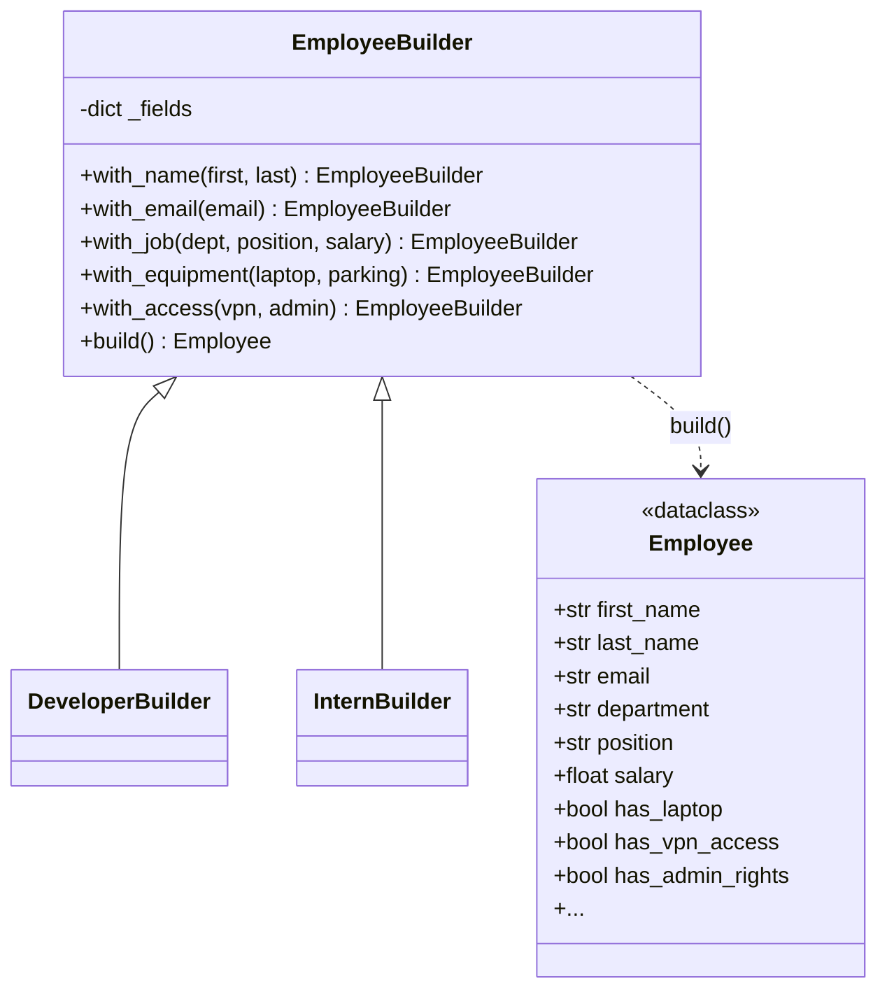
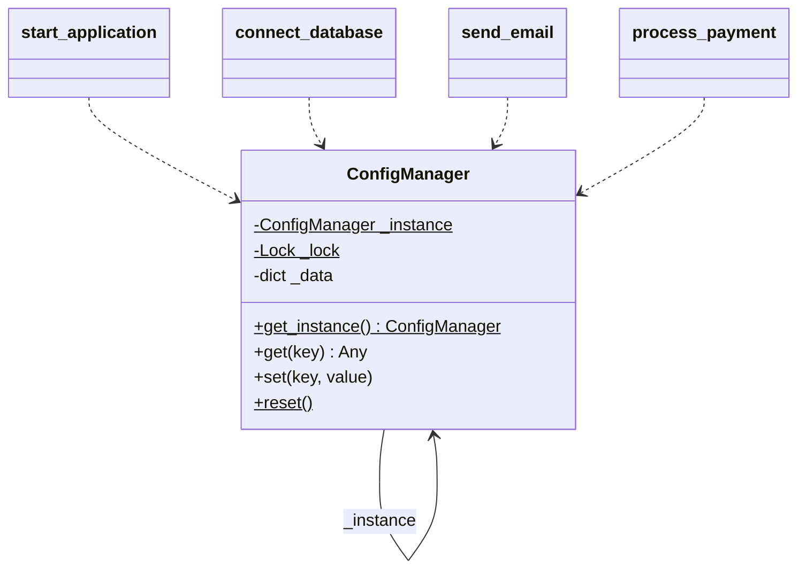
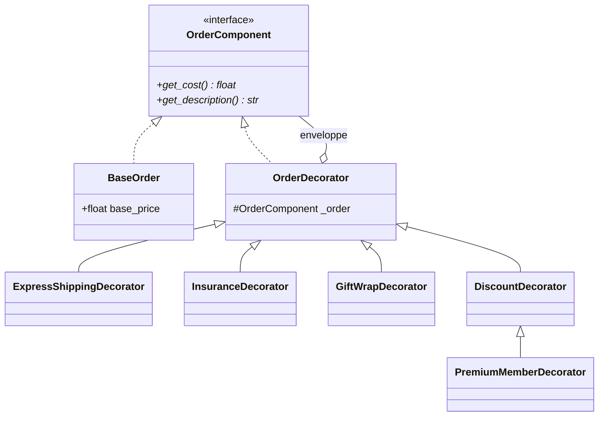
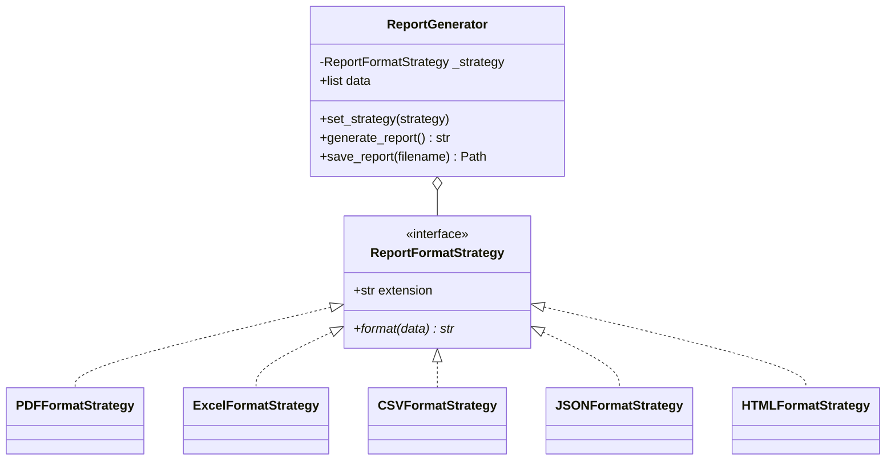
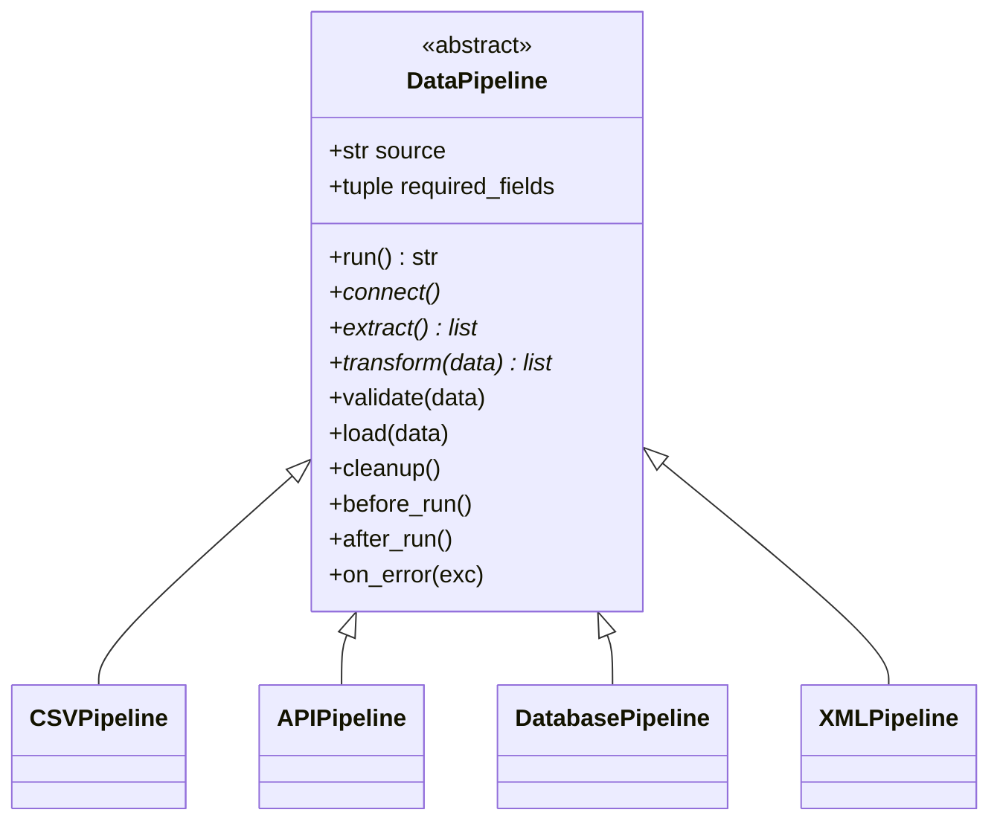

# 05 - Design patterns in practice

Énoncés :
[creational](https://courses.dallard.tech/sys_design/creational_pattern/) ·
[structural](https://courses.dallard.tech/sys_design/structural_pattern/) ·
[behavioral](https://courses.dallard.tech/sys_design/behavioral_pattern/)

Chaque fichier contient en docstring les *problèmes identifiés* dans le code
legacy, puis la solution refactorée. Les diagrammes UML demandés avant de
coder sont ci-dessous.

| Pattern | Fichier | Exercice |
|---|---|---|
| Factory Method | [`creational/factory.py`](creational/factory.py) | système de paiement |
| Builder | [`creational/builder.py`](creational/builder.py) | onboarding RH |
| Singleton | [`creational/singleton.py`](creational/singleton.py) | gestionnaire de config |
| Adapter | [`structural/adapter.py`](structural/adapter.py) | rapports XML → JSON |
| Decorator | [`structural/decorator.py`](structural/decorator.py) | prix des commandes |
| Strategy | [`behavioral/strategy.py`](behavioral/strategy.py) | rapports multi-formats (+ HTML) |
| Template Method | [`behavioral/template_method.py`](behavioral/template_method.py) | pipelines ETL (+ XML) |

```bash
python 05_design_patterns/creational/factory.py   # etc.
pytest tests/test_design_patterns.py
```

## Factory Method


## Builder



## Singleton



## Adapter


## Decorator



Exemple du sujet (100 € + express + assurance + emballage, -15 %, -10 % premium) :
`(100 + 15 + 5 + 5) × 0.85 × 0.90 ≈ 95.62 €`.

## Strategy



> Remarque : l'énoncé est rangé sous « Template Method » sur le site mais
> demande explicitement un **Strategy** pour cet exercice.

## Template Method



`run()` fixe l'ordre `connect → extract → transform → validate → load → cleanup` ;
`cleanup()` est dans un `finally` donc impossible à sauter, même en cas d'erreur.
